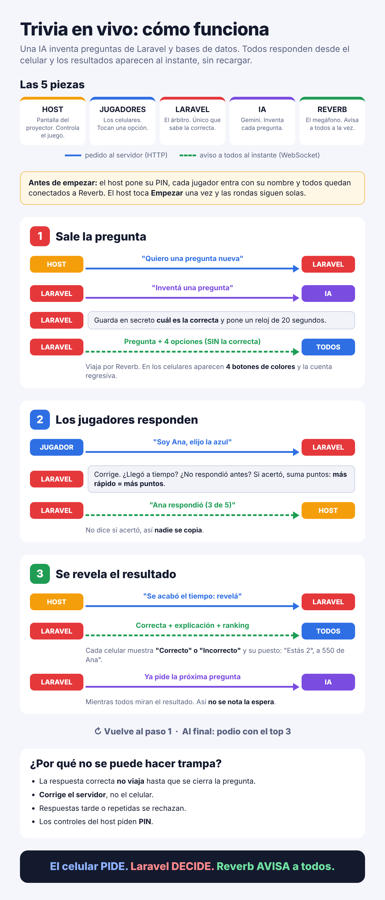

# Trivia en Vivo · Laravel + Reverb + IA

Juego de preguntas en tiempo real, estilo Kahoot, para repasar los contenidos de **Programación IV** (Tecnicatura Universitaria en Programación, UTN FRRe, sede Formosa).

Una pantalla principal (el **host**, pensada para el proyector) muestra preguntas generadas con IA sobre la materia. Los jugadores se unen desde el celular escaneando un código QR, responden en 4 botones de colores y el ranking se actualiza al instante, sin recargar la página.



---

## Funcionalidades

- **Tiempo real con WebSockets:** Laravel Reverb como servidor y Laravel Echo en el navegador.
- **Preguntas generadas con IA** (Google Gemini) sobre los temas de la planificación de la materia, con su explicación.
- **Banco de preguntas en base de datos:** se generan por lotes antes de jugar, así la partida no depende de la IA en vivo.
- **Modo automático:** el host toca "Empezar" una vez y las rondas avanzan solas: pregunta, cuenta regresiva, revelación y ranking.
- **Puntos por velocidad:** entre 500 y 1000 puntos por respuesta correcta, según qué tan rápido se respondió.
- **Ranking en vivo** en el proyector y en cada celular, con empates calculados en el servidor y podio final.
- **Ingreso por QR** desde el celular.
- **Seguridad:** PIN para el host, middleware, rate limiting, token por jugador, CSRF, y la respuesta correcta nunca viaja antes de tiempo.

## Cómo funciona

```
Celular / Host  ──HTTP (fetch)──▶  Laravel  ──HTTP firmado──▶  Reverb  ══WebSocket══▶  todos los navegadores
                                     │
                                     ├── corrige y suma puntos (el servidor decide)
                                     ├── guarda el estado del juego (Cache)
                                     └── banco de preguntas (MySQL / SQLite) ◀── IA Gemini (por lotes)
```

**Regla de oro:** el navegador **pide** por HTTP, el servidor **decide** y Reverb **avisa** a todos por WebSocket.

### Eventos que viajan por el canal `trivia`

| Evento | Cuándo | Qué lleva |
|---|---|---|
| `JugadorUnido` | Un jugador entra a la sala | Nombre y cantidad de jugadores |
| `PreguntaLanzada` | Empieza una pregunta | Tema, texto, opciones y hora de cierre (**sin** la respuesta correcta) |
| `RespuestaRecibida` | Un jugador responde | Nombre y cantidad de respuestas (no dice si acertó) |
| `ResultadoRevelado` | Se cierra la pregunta | Respuesta correcta, explicación y ranking con puestos |
| `PartidaReiniciada` | El host reinicia | — |

## Tecnologías

- **Backend:** PHP 8.3, Laravel 13, Laravel Reverb
- **Frontend:** Blade, JavaScript, Laravel Echo (pusher-js), Vite
- **Base de datos:** MySQL o SQLite (banco de preguntas y cache)
- **IA:** API de Google Gemini
- **QR:** chillerlan/php-qrcode (se genera en el servidor, funciona sin internet)

## Requisitos

- PHP 8.3 o superior
- Composer
- Node.js y npm
- Una API key de Gemini ([Google AI Studio](https://aistudio.google.com))

## Instalación

```bash
git clone https://github.com/AlexanderB97/trivia-reverb.git
cd trivia-reverb

composer install
npm install

cp .env.example .env
php artisan key:generate
php artisan reverb:install      # genera REVERB_APP_ID, KEY y SECRET
php artisan migrate
```

### Variables del `.env`

| Variable | Valor | Para qué |
|---|---|---|
| `BROADCAST_CONNECTION` | `reverb` | Los eventos se emiten por Reverb |
| `QUEUE_CONNECTION` | `sync` | Los eventos se envían al instante, sin worker de colas |
| `REVERB_HOST` | `localhost` o la IP de la notebook | Dónde está Reverb. Para jugar desde celulares, usar la IP de la red. |
| `REVERB_PORT` / `REVERB_SCHEME` | `8080` / `http` | Puerto y protocolo de Reverb |
| `GEMINI_API_KEY` | tu clave | Acceso a la IA (**secreta**, nunca con prefijo `VITE_`) |
| `GEMINI_MODEL` | por ejemplo `gemini-3.5-flash` | Modelo de Gemini a usar |
| `TRIVIA_HOST_PIN` | un número | PIN para entrar a `/host` |
| `TRIVIA_URL_JUGAR` | (opcional) | URL fija para el QR. Si queda vacía, se arma con `REVERB_HOST`. |

> Las variables `VITE_*` se escriben dentro del JavaScript al compilar: si cambiás `REVERB_HOST`, volvé a correr `npm run build`.

## Uso

### 1. Generar el banco de preguntas (antes de jugar)

```bash
php artisan trivia:generar 30     # genera 30 preguntas en lotes de 10
php artisan trivia:reciclar       # vuelve a habilitar las preguntas ya usadas
```

### 2. Levantar los servidores

```bash
npm run build
php artisan serve --host=0.0.0.0 --port=8000
php artisan reverb:start --host=0.0.0.0
```

### 3. Jugar

- **Host (proyector):** `http://localhost:8000/host` → ingresar el PIN → configurar la partida → **Empezar**.
- **Jugadores:** escanear el QR que muestra el host, o entrar a `http://IP-DE-LA-NOTEBOOK:8000/jugar`.

### Jugar desde celulares en la misma red

1. `ipconfig` (Windows) para ver la IP de la notebook.
2. Poner esa IP en `REVERB_HOST`, después correr `npm run build` y `php artisan config:clear`.
3. La red Wi-Fi tiene que estar como **Privada**, con los puertos **8000** y **8080** permitidos en el firewall.
4. Celulares y notebook en la **misma red** (o en el hotspot de un celular).

## Estructura principal

```
app/
├── Console/Commands/          trivia:generar, trivia:reciclar
├── Events/                    eventos que viajan por Reverb
├── Http/Controllers/          TriviaController (lógica del juego)
├── Http/Middleware/           EnsureTriviaHost (PIN del host)
├── Models/Pregunta.php        banco de preguntas
└── Services/                  GeneradorPreguntas (IA Gemini)
config/trivia.php              temas de la materia, PIN, URL del QR
resources/views/trivia/        host.blade.php, jugar.blade.php, pin.blade.php
routes/web.php
```

## Seguridad

- La **respuesta correcta** solo se envía en `ResultadoRevelado`, cuando la pregunta ya está cerrada.
- **Corrige el servidor**, no el navegador. Rechaza respuestas fuera de tiempo o repetidas.
- Las rutas del host están protegidas por **PIN + middleware** (403 sin autorización).
- **Rate limiting** en el login del PIN, en las rutas que llaman a la IA y en las respuestas.
- Un navegador puede **escuchar** el canal, pero no **publicar**: para publicar hace falta firmar con `REVERB_APP_SECRET`, que solo tiene el servidor.
- Las claves (`.env`) **no** se suben al repositorio.

---

Proyecto realizado para **Programación IV** · TUP · UTN FRRe, sede Formosa · 2026
